# Session 01: Kubernetes is a set of control loops

**Dates:** 2026-10-17 to 2026-10-18
**Plan position:** Phase 0, Week 1
**Status:** lab and reading assigned; homework answers not yet submitted.

[← Back to index](../index.md) · [Previous: Session 00, the learning plan](00-learning-plan.md)

---

## Before you start: key terms

No prior knowledge assumed. Read this first; the rest of the session builds on these words.

### The big picture

- **Container:** a packaged program plus everything it needs to run (libraries, files), started as an isolated process. Think of a shipping container: the same box runs the same way on any machine.
- **Kubernetes:** software that runs containers across many machines for you. You describe what you want ("3 copies of this web server, always"), and Kubernetes keeps it that way, restarting and moving things as machines fail.
- **Cluster:** the group of machines Kubernetes manages, treated as one big computer.
- **Node:** one machine in the cluster. **Worker nodes** run your containers; the **control plane** nodes run Kubernetes itself.
- **Control plane:** the "brain" of the cluster: the components that store what you want and decide what to do about it. Its parts are below.

### The control plane's parts

- **API server:** the front door. Every request, from you or from any component, goes through it. It checks who you are, whether you're allowed, and whether the request makes sense, then stores the result.
- **etcd:** the cluster's database. It stores every record: every pod, deployment and setting. Only the API server talks to it.
- **Controller:** a background worker that watches one type of record and makes the real world match it. Like a thermostat: it compares the room's temperature (actual) with the setting (desired) and acts on the difference, forever.
- **Controller manager:** one program that runs dozens of built-in controllers.
- **Scheduler:** the controller that picks which node each new pod runs on.

### On each node

- **kubelet:** the agent on every node. It watches for pods assigned to its node and makes sure their containers are running.
- **Container runtime:** the software the kubelet asks to actually start containers (containerd, in this course).

### The objects you work with

- **Pod:** the smallest thing Kubernetes runs: one container, or a few that must live together. Pods are disposable; they get replaced, not repaired.
- **ReplicaSet:** a record that says "keep N identical pods running". Its controller creates or deletes pods to match N.
- **Deployment:** a record one level up that manages ReplicaSets, so you can roll out a new version gradually and roll back.
- **Namespace:** a named folder inside the cluster that groups objects, such as one per team or customer.
- **Label and selector:** labels are tags on objects (`app=web`); selectors find objects by tag. A ReplicaSet finds "its" pods by selector.
- **ownerReferences:** a field saying "this object belongs to that one" (a pod belongs to a ReplicaSet). It's how Kubernetes knows what to clean up.
- **Garbage collection:** the controller that deletes objects whose owner is gone. Delete a Deployment and its ReplicaSets and pods disappear too.

### How the pieces cooperate

- **Desired state vs. actual state:** what you asked for (stored in etcd) vs. what's really running. All of Kubernetes is about closing the gap.
- **Reconciliation (control loop):** a controller's endless cycle: look at desired state, look at actual state, act on the difference, repeat.
- **Watch:** a subscription to changes. Instead of asking "anything new?" over and over, a component keeps a connection open and the API server pushes each change as it happens.
- **Level-triggered vs. edge-triggered:** an edge-triggered system reacts to *events* ("a pod was deleted", so create one). A level-triggered system reacts to the *current state* ("I see 2 pods, I want 3"). Kubernetes controllers are level-triggered, so a missed event never matters: the next look at the state fixes it.
- **resourceVersion and optimistic concurrency:** every object carries a version number that changes on each write. An update based on an old version is rejected with a conflict, so two writers can't silently overwrite each other. No locks are needed.
- **Static pod:** a pod the kubelet starts from a file on its own disk, without asking the API server. That's how the control plane can run as pods before the API server exists.

### Tools

- **kubectl:** the command-line tool for talking to the API server.
- **kind ("Kubernetes in Docker"):** a tool that runs a whole cluster on your laptop, with each "node" being a Docker container. Used for learning and testing.
- **kube-system:** the namespace where Kubernetes keeps its own components.

---

## Lab environment check

Checked on your Mac (Apple Silicon, 48 GB RAM):

| Tool | Status |
|---|---|
| Docker | 29.8.2 installed |
| kind | 0.33.0 installed |
| kubectl | v1.37.1 installed |
| Homebrew | installed |
| Go | not installed. Needed in Phase 1 for writing controllers. |
| k9s | not installed (optional) |

---

## The one idea for this week

Kubernetes doesn't *execute* commands. You write a **desired state** to the API server, which stores it in etcd. Then many independent **controllers** each watch the API and keep nudging the actual state toward the desired state.

- The **scheduler** is one of these loops. It watches for pods with no node and assigns one.
- The **controller manager** runs dozens of them: Deployments, ReplicaSets, Jobs, Endpoints and more.
- The **kubelet** on each node is another loop. It watches for pods assigned to its node and runs them.

None of these components call each other directly. They communicate only by reading and writing objects through the API server. That's also the pattern your Agent Platform's operators will follow.

---

## The diagram



The animation cycles through the overview and all seven steps, about 4.5 seconds each (36 seconds per loop). Amber marks the parts a step uses or changes; red marks the part you break on purpose.

Other versions:
- [Static diagram](../assets/lab1-cluster.svg), with no highlighting
- [Interactive version](../assets/lab1-cluster-interactive.html), with a button per step. Open it in a browser.

What each step touches:

| Step | Uses or changes | Broken on purpose | What happens |
|---|---|---|---|
| Overview | | | Every arrow points at the API server. The scheduler, controller manager and both worker kubelets watch it; none of them talk to each other or to etcd directly. |
| 1 · Static pods | control-plane kubelet, API server, etcd, scheduler, controller manager | | The control-plane kubelet starts the four control-plane components from files in `/etc/kubernetes/manifests`, without asking the API server. |
| 2 · Ownership | kubectl, API server, etcd, controller manager, pods | | kubectl writes a Deployment. The controller manager creates a ReplicaSet, then Pods. All three are objects in etcd, linked by ownerReferences. |
| 3 · Reconcile | controller manager, scheduler, worker kubelets, pods | | You delete a pod. The controller manager sees 2 of 3 and creates one, the scheduler assigns it a node, and that node's kubelet starts it. |
| 4 · Raw API | kubectl, API server | | kubectl is just an HTTP client. The `?watch=1` stream is the same mechanism every controller uses. |
| 5 · Conflict | kubectl, API server, etcd | | The stale file carries an old resourceVersion. The API server rejects the write. No locks involved. |
| 6 · Break scheduler | controller manager, new pod | scheduler | The controller manager still creates pods, but nobody assigns them a node, so they stay Pending. |
| 7 · Break controller mgr | pods | controller manager | Deleted pods aren't replaced. When it restarts, it compares desired vs actual state and catches up, even though it missed the deletes. |

**Simplifications in the diagram:**
- **Worker kubelets have no arrows**, to keep it readable. They also watch the API server, asking for pods assigned to their own node.
- **Pod placement is illustrative.** The scheduler decides where pods really land; check with `kubectl get pods -o wide`.
- **The objects you create** (Deployment, ReplicaSet, Pods) exist only as records in etcd until a kubelet turns a Pod into a running container.

---

## Lab 1: watch the loops, then break them (60–75 min)

### Before Step 1: create the cluster

> **Q: Do I run the commands listed before Step 1?**
>
> Yes. Before Step 1 you run one command, the cluster-creation block. Every later step uses that cluster.

1. **Make sure Docker is running.** kind builds each Kubernetes "node" as a Docker container. Check it:

   ```bash
   docker info --format '{{.ServerVersion}}'
   ```

   A version number means you're ready. An error means Docker isn't running yet.

2. **Create the cluster.** Paste the whole block, from `cat <<'EOF'` down to the final `EOF`. It's a single command: the middle lines are the cluster config fed into `kind create cluster`. It takes a minute or two and ends with "Set kubectl context to kind-learn".

   ```bash
   cat <<'EOF' | kind create cluster --name learn --config -
   kind: Cluster
   apiVersion: kind.x-k8s.io/v1alpha4
   nodes:
   - role: control-plane
   - role: worker
   - role: worker
   EOF
   ```

3. **Confirm it worked:**

   ```bash
   kubectl get nodes
   ```

   You should see `learn-control-plane`, `learn-worker` and `learn-worker2`. They may show `NotReady` for about 30 seconds while networking starts. Wait until all three say `Ready`.

### Step 1: The control plane is just pods

```bash
kubectl get pods -n kube-system -o wide
```

```bash
docker exec learn-control-plane ls /etc/kubernetes/manifests
```

**What to notice:** the API server, scheduler, controller manager and etcd run as *static pods*. The kubelet starts them from files in that directory, without asking the API server. This is how Kubernetes bootstraps itself.

### Step 2: Ownership chains

```bash
kubectl create deployment web --image=nginx --replicas=3
```

```bash
kubectl get deploy,rs,pods -l app=web
```

```bash
kubectl get pod -l app=web -o jsonpath='{.items[0].metadata.ownerReferences}'
```

**What to notice:** a Deployment owns a ReplicaSet, and the ReplicaSet owns the Pods. Each layer is managed by a *different* controller. Your `AgentSession` operator will build the same kind of chain.

### Step 3: Watch reconciliation happen

In a second terminal, leave this running:

```bash
kubectl get pods -l app=web -w
```

In the first terminal, delete a pod and watch it come back:

```bash
kubectl delete pod -l app=web --wait=false
```

The ReplicaSet controller saw that the actual count was below the desired 3 and created replacements. Nobody told it to.

### Step 4: Talk to the API directly

See the HTTP calls kubectl makes:

```bash
kubectl get pods -v=8 2>&1 | grep -E "GET|Response Status"
```

Open a raw watch stream, the same mechanism every controller uses. Delete a pod in the other terminal while it runs, then press Ctrl-C:

```bash
kubectl get --raw "/api/v1/namespaces/default/pods?watch=1" | cut -c1-160
```

### Step 5: Optimistic concurrency

```bash
kubectl get deploy web -o yaml > web-stale.yaml
```

```bash
kubectl scale deploy web --replicas=4
```

```bash
kubectl replace -f web-stale.yaml
```

**What to notice:** the replace fails with "the object has been modified". Every object carries a `resourceVersion`, and a write based on an outdated version is rejected. There are no locks, which is why controllers must re-read the object and retry.

### Step 6: Break the scheduler

The kubelet stops the scheduler within about 20 seconds of its manifest disappearing:

```bash
docker exec learn-control-plane mv /etc/kubernetes/manifests/kube-scheduler.yaml /root/
```

```bash
kubectl scale deploy web --replicas=6
```

```bash
kubectl get pods -l app=web -o wide
```

The new pods stay **Pending** with no node. The ReplicaSet controller still created them; only the scheduler's loop is missing. Restore it and watch them get scheduled:

```bash
docker exec learn-control-plane mv /root/kube-scheduler.yaml /etc/kubernetes/manifests/
```

### Step 7: Break the controller manager

```bash
docker exec learn-control-plane mv /etc/kubernetes/manifests/kube-controller-manager.yaml /root/
```

Wait about 20 seconds, then delete two pods:

```bash
kubectl get pods -l app=web -o name | head -2 | xargs kubectl delete --wait=false
```

(This is a simpler version of the command from the live session, which did the same thing with a fallback.)

They don't come back. Restore the controller manager:

```bash
docker exec learn-control-plane mv /root/kube-controller-manager.yaml /etc/kubernetes/manifests/
```

**What to notice:** on restart it catches up immediately, even though it never saw the delete events. Controllers compare current state with desired state; they don't replay a history of events. This is what **level-triggered** means, and it's the most important property to require in your team's operators.

### Clean up

Run this when you're finished, or keep the cluster for next session:

```bash
kind delete cluster --name learn
```

---

## Reading: *Borg, Omega, and Kubernetes* (about an hour)

[queue.acm.org/detail.cfm?id=2898444](https://queue.acm.org/detail.cfm?id=2898444)

Read with three questions in mind:
1. Why did Kubernetes choose a shared, persistent API store with many independent controllers instead of one central brain?
2. What do the authors say about why **labels** beat hard-coded groupings?
3. Which of the "lessons learned" mistakes could your Agent Platform repeat? Check the sections on ports and IPs and on dependency management in particular.

---

## Homework: answer these back to your coach

1. In Step 6, why were the pods created at all if the scheduler was down? What does that tell you about how the components depend on each other?
2. In Step 7, the controller manager missed the delete events, yet it still recovered. Why? What would go wrong if it had been built on event handling ("when a pod is deleted, create one")?
3. In Step 5, why doesn't Kubernetes use locks? What does that mean for a controller you'd write?
4. **The platform question:** an agent session is running in a pod and the node dies. Using only what you saw today, which loops notice, in what order, and what happens to the agent's in-progress work? (There's a trap in this one.)

**Bonus question from the diagram:** the API server is the only box everything depends on. What do you expect to happen to *running* pods if you stopped it, and why? Predict before you test.

### My answers

1. The manager creates them but the scheduler is not there, so they don't get a node assigned.
2. There is autoscaling so if the controller manager is missing, when it recovers it goes and checks the configuration in etcd.
3. It uses version control so when it recovers it cannot recover from a stale copy.
4. _(not answered; see the hints, experiment and model answer below)_
5. Bonus: _(not answered; see the model answer below)_

### Coach feedback

**Overall:** your intuition is right: there's a desired state, and something compares it with reality. What's missing is precision in three places, and those words matter in design reviews.

**Q1: mostly right.** The ReplicaSet controller created the pods; the scheduler owns one field, `spec.nodeName`, and nobody filled it in. Missing piece, the "what does it tell you" half: the components never call each other. Each loop owns one part of the work and they meet only through objects in the API. "Pending with no node" is a perfectly valid state, so one dead loop degrades one function instead of taking down the system.

**Q2: right idea, two corrections.**
- **Autoscaling isn't involved.** `replicas: 6` is a fixed desired count you set. Autoscaling (HPA) is a *different* controller that changes that number. Here the mechanism is **reconciliation**: compare desired with actual and act on the difference.
- **No controller reads etcd.** Only the API server talks to etcd. On restart the controller manager does a full LIST through the API server, rebuilds its cache, and sees 4 pods where 6 are desired.
- **The event-driven version fails because** a missed event means permanent drift (nothing ever re-checks), a duplicated event means double creation, and out-of-order events confuse it. A level-triggered loop doesn't care how it got here; it only looks at the current state. That's why it recovered.

**Q3: close on the mechanism, wrong on the purpose.** It's **optimistic concurrency**: each object has a `resourceVersion`, and a write based on an old version is rejected with a 409 Conflict. It's about **concurrent writers**, not recovery.
- **Why no locks:** with many independent writers across a network, a client that crashes while holding a lock blocks everyone, so you'd need leases, timeouts and deadlock handling. Conflicts are rare, so "try, and retry if someone beat you" is cheaper and simpler.
- **What it means for your controller:** expect any write to fail with a conflict. Then re-read, recompute and retry. Make reconcile idempotent, so running it twice gives the same result. Never treat your in-memory copy as the truth.

**Q4: not answered yet.** Hints, without giving it away:
- The dead node's kubelet can't report that it's dead. So *who* notices, and how long do they wait? (Look up the node lifecycle controller and node Leases.)
- Once the node is marked unreachable, how long until its pods are evicted? (Look up the default `tolerationSeconds` for `node.kubernetes.io/unreachable`.)
- **The trap:** suppose a replacement pod does appear. Is it the *same* pod? What happened to anything the agent kept in memory or in an `emptyDir` volume? And what if the pod wasn't owned by a ReplicaSet at all?

**Experiment to answer it with evidence.** Simulate a node death in your kind cluster and watch it unfold (it takes over 5 minutes):

```bash
kubectl get nodes,pods -o wide -w
```

```bash
docker stop learn-worker
```

Note the time each change appears, then restart the node with `docker start learn-worker`.

### Model answers

**Q1. Why were pods created while the scheduler was down?**

Creating pods and placing them are separate jobs owned by separate loops. The ReplicaSet controller (in the controller manager) saw 3 pods where 6 were desired and created 3 Pod objects. Placing a pod means filling in its `spec.nodeName`, and only the scheduler does that. With the scheduler gone, the new pods stayed Pending.

What it tells you: the components don't call each other. Each loop owns one piece of the work and they coordinate only through objects in the API server. "Pending, no node" is a valid state that the next loop picks up whenever it's running. So a failed component degrades one function instead of the whole system, and work resumes when it comes back.

**Q2. Why did the controller manager recover after missing the delete events?**

Because its controllers are **level-triggered**. On restart, the controller manager lists the current state through the API server (it never reads etcd directly) and rebuilds its cache. The ReplicaSet controller then compares desired (`replicas: 6`) with actual (the pods matching its selector), sees a shortfall and creates the difference. It doesn't need to know *what happened*, only *what is*. No autoscaling is involved: `replicas` is a fixed number you set.

An **edge-triggered** design ("when a pod is deleted, create one") would break in three ways:
- **Missed events** (like a restart) leave the system wrong forever, because nothing re-checks.
- **Duplicated events** create extra pods.
- **Out-of-order events** make it act on a stale picture.

Real controllers use events only as a hint that something *might* have changed. Each one triggers a full comparison of desired and actual state, and controllers also re-check everything periodically.

**Q3. Why doesn't Kubernetes use locks?**

It uses **optimistic concurrency**. Every object has a `resourceVersion` that changes on each write. An update carries the version it was based on, and the API server rejects it with a 409 Conflict if the object has changed since. That's what `kubectl replace` hit in Step 5.

Locks would be worse in a distributed system with many independent writers. A client that crashes holding a lock blocks everyone, so you'd need leases, timeouts and deadlock handling, and every write would pay that cost. Conflicts are rare, so "write, and retry if someone beat you" is simpler and scales better.

For a controller you write:
- **Expect conflicts.** On a 409, re-read the latest object, recompute and retry. Don't overwrite blindly.
- **Make reconcile idempotent.** Running it twice, or a thousand times, must give the same result.
- **Never treat your in-memory copy as the truth.** It's a cache of the API server.
- **Write only the fields you own,** using patches or server-side apply, so you don't clobber other controllers' changes.

**Q4. A node dies while an agent session runs on it. What happens?**

In order:

1. **Nobody hears from the node.** The kubelet normally renews a Lease object every 10 seconds and reports node status. A dead kubelet can't report that it's dead, so nothing happens immediately.
2. **The node lifecycle controller** (in the controller manager) notices the missed heartbeats after the node-monitor grace period, roughly 40–50 seconds depending on version. It marks the node's Ready condition `Unknown` and adds the taint `node.kubernetes.io/unreachable:NoExecute`.
3. **Pods wait out their toleration.** By default every pod tolerates that taint for 300 seconds (`tolerationSeconds: 300`, added at admission). For about 5 more minutes, the API still says the pod is Running on that node.
4. **Eviction.** After the toleration expires, the pod is marked for deletion. Because the kubelet is gone, it can't confirm the container stopped, so the old Pod object sits in `Terminating` until the node returns or someone force-deletes it.
5. **Replacement (only for some owners).** The ReplicaSet controller ignores pods being deleted, sees a shortfall and creates a new pod. The scheduler places it on a healthy node and that node's kubelet starts it. In total the session is down for roughly 5–6 minutes.

**The trap:** the replacement is a **new pod**: new name, new IP, empty memory, and a fresh `emptyDir`. Kubernetes restores the **count**, not the **session**. The agent's conversation state, scratch files and in-flight tool calls are gone. Worse, a tool call may have *completed its side effect* (sent an email, written to a database) before the node died, with no record that it did.

It also depends on the owner:
- **A bare pod** with no controller is never recreated.
- **A StatefulSet pod** is *not* replaced while the old one is stuck in `Terminating`, because StatefulSets guarantee at most one pod per identity. It stays down until the node returns or someone force-deletes the old pod.

Implications for the Agent Platform:
- **Keep session state outside the pod.** Checkpoint it, or run the agent loop on durable execution such as Temporal.
- **Make tool calls idempotent,** for example with idempotency keys, so a resumed session can retry safely.
- **Consider a shorter `tolerationSeconds`** for agent pods, trading faster failover against evicting pods during brief network blips.
- **Treat session recovery as a platform feature with an SLO,** not something Kubernetes gives you for free.

**Bonus. What happens to running pods if the API server stops?**

**They keep running.** The data plane doesn't depend on the control plane minute to minute. The container runtime keeps containers alive, and the kubelet still restarts crashed containers locally according to their `restartPolicy`. Service routing keeps working because kube-proxy (or Cilium) already programmed the rules on each node.

What stops is everything that needs a change:
- `kubectl` and every other client fail.
- No scheduling, no new pods and no scaling.
- Controllers can't see or fix anything, so a pod lost on a dead node isn't replaced.
- Kubelets can't report status, and nodes can't be marked NotReady.

The cluster freezes in its last known state. It doesn't fall over, but it can't heal itself either. This is why managed Kubernetes runs several API server replicas, and why API server availability is the control-plane SLO that matters most.


## Resources

### Books
- *Kubernetes: Up and Running*, 3rd ed. (Burns, Beda, Hightower, Evenson). Chapters: "Introduction", "Pods", "Labels and Annotations", "ReplicaSets", "Deployments". The gentlest path through this session's objects.
- *Kubernetes Patterns*, 2nd ed. (Ibryam, Huß). Chapters: "Declarative Deployment" and "Controller". Why "describe the goal, let a loop get there" works.
- *Programming Kubernetes* (Hausenblas, Schimanski). Chapter 1, "Introduction", and Chapter 2, "Kubernetes API Basics": watches, resource versions and how controllers are built, for when you want the next level down.

### Papers
- [Large-scale cluster management at Google with Borg](https://research.google/pubs/large-scale-cluster-management-at-google-with-borg/) (EuroSys 2015). Kubernetes' predecessor.
- *Omega: flexible, scalable schedulers for large compute clusters* (EuroSys 2013). The shared-state design that inspired the API server plus independent controllers.
- [Borg, Omega, and Kubernetes](https://queue.acm.org/detail.cfm?id=2898444) (ACM Queue 2016). Short, and the most important one: why Kubernetes is built as a database plus control loops.

### Articles and docs
- [Kubernetes Components](https://kubernetes.io/docs/concepts/overview/components/): the control plane and node parts in one page.
- [Controllers](https://kubernetes.io/docs/concepts/architecture/controller/): the control-loop idea, with the thermostat analogy.
- [Deployments](https://kubernetes.io/docs/concepts/workloads/controllers/deployment/): what you created in the lab.
- [Garbage Collection](https://kubernetes.io/docs/concepts/architecture/garbage-collection/): owner references and cascading deletion.
- [Kubernetes API Concepts](https://kubernetes.io/docs/reference/using-api/api-concepts/): watches and resource versions.
- [Static Pods](https://kubernetes.io/docs/tasks/configure-pod-container/static-pod/): how the control plane bootstraps.
- [Taints and Tolerations](https://kubernetes.io/docs/concepts/scheduling-eviction/taint-and-toleration/): how pods get evicted from a dead node (homework question 4).
- [kind quick start](https://kind.sigs.k8s.io/docs/user/quick-start/): the tool used in the lab.

### Videos
- [The Illustrated Children's Guide to Kubernetes](https://www.youtube.com/watch?v=4ht22ReBjno) (Deis, about 8 min). The friendliest possible first look at pods, ReplicaSets and Services.
- [Kubernetes Deconstructed: Understanding Kubernetes by Breaking It Down](https://www.youtube.com/watch?v=90kZRyPcRZw) (Carson Anderson, KubeCon). Walks through each component and how they cooperate, with clear visuals. The best match for this session.
- [Kubernetes: The Documentary, Part 1](https://www.youtube.com/watch?v=BE77h7dmoQU) and [Part 2](https://www.youtube.com/watch?v=318elIq37PE) (CultRepo, about 25 and 30 min). The history: Borg, Docker, and why Google open-sourced Kubernetes.

---

**Next session:** review the homework answers, then start *Kubernetes the Hard Way*, including setting up Linux VMs on an Apple Silicon Mac.
