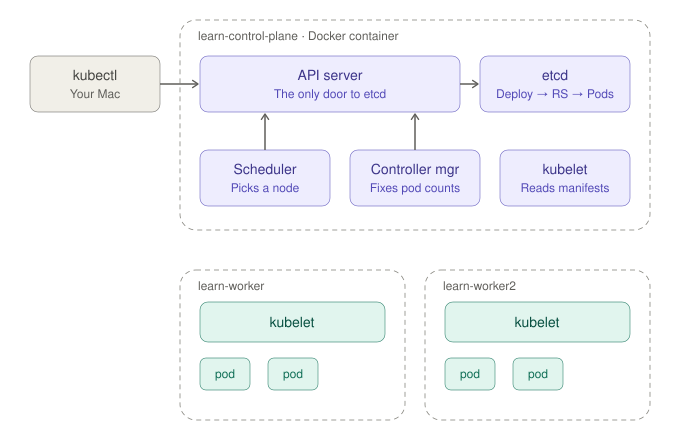

# Session 01: Kubernetes is a set of control loops

**Dates:** 2026-10-17 to 2026-10-18
**Plan position:** Phase 0, Week 1
**Status:** lab and reading assigned; homework answers not yet submitted.

[← Back to index](../index.md) · [Previous: Session 00, the learning plan](00-learning-plan.md)

---

## Lab environment check

Checked on your Mac (Apple Silicon, 48 GB RAM):

| Tool | Status |
|---|---|
| Docker | 29.8.2 installed |
| kind | 0.33.0 installed |
| kubectl | v1.37.1 installed |
| Homebrew | installed |
| Go | not installed. Needed in Phase 1 for writing controllers. |
| k9s | not installed (optional) |

---

## The one idea for this week

Kubernetes doesn't *execute* commands. You write a **desired state** to the API server, which stores it in etcd. Then many independent **controllers** each watch the API and keep nudging the actual state toward the desired state.

- The **scheduler** is one of these loops. It watches for pods with no node and assigns one.
- The **controller manager** runs dozens of them: Deployments, ReplicaSets, Jobs, Endpoints and more.
- The **kubelet** on each node is another loop. It watches for pods assigned to its node and runs them.

None of these components call each other directly. They communicate only by reading and writing objects through the API server. That's also the pattern your Agent Platform's operators will follow.

---

## The diagram



The interactive version, with a button per lab step, is in [`assets/lab1-cluster-interactive.html`](../assets/lab1-cluster-interactive.html). Open it in a browser.

What each step touches:

| Step | Uses or changes | Broken on purpose | What happens |
|---|---|---|---|
| Overview | | | Every arrow points at the API server. The scheduler, controller manager and both worker kubelets watch it; none of them talk to each other or to etcd directly. |
| 1 · Static pods | control-plane kubelet, API server, etcd, scheduler, controller manager | | The control-plane kubelet starts the four control-plane components from files in `/etc/kubernetes/manifests`, without asking the API server. |
| 2 · Ownership | kubectl, API server, etcd, controller manager, pods | | kubectl writes a Deployment. The controller manager creates a ReplicaSet, then Pods. All three are objects in etcd, linked by ownerReferences. |
| 3 · Reconcile | controller manager, scheduler, worker kubelets, pods | | You delete a pod. The controller manager sees 2 of 3 and creates one, the scheduler assigns it a node, and that node's kubelet starts it. |
| 4 · Raw API | kubectl, API server | | kubectl is just an HTTP client. The `?watch=1` stream is the same mechanism every controller uses. |
| 5 · Conflict | kubectl, API server, etcd | | The stale file carries an old resourceVersion. The API server rejects the write. No locks involved. |
| 6 · Break scheduler | controller manager, new pod | scheduler | The controller manager still creates pods, but nobody assigns them a node, so they stay Pending. |
| 7 · Break controller mgr | pods | controller manager | Deleted pods aren't replaced. When it restarts, it compares desired vs actual state and catches up, even though it missed the deletes. |

**Simplifications in the diagram:**
- **Worker kubelets have no arrows**, to keep it readable. They also watch the API server, asking for pods assigned to their own node.
- **Pod placement is illustrative.** The scheduler decides where pods really land; check with `kubectl get pods -o wide`.
- **The objects you create** (Deployment, ReplicaSet, Pods) exist only as records in etcd until a kubelet turns a Pod into a running container.

---

## Lab 1: watch the loops, then break them (60–75 min)

### Before Step 1: create the cluster

> **Q: Do I run the commands listed before Step 1?**
>
> Yes. Before Step 1 you run one command, the cluster-creation block. Every later step uses that cluster.

1. **Make sure Docker is running.** kind builds each Kubernetes "node" as a Docker container. Check it:

   ```bash
   docker info --format '{{.ServerVersion}}'
   ```

   A version number means you're ready. An error means Docker isn't running yet.

2. **Create the cluster.** Paste the whole block, from `cat <<'EOF'` down to the final `EOF`. It's a single command: the middle lines are the cluster config fed into `kind create cluster`. It takes a minute or two and ends with "Set kubectl context to kind-learn".

   ```bash
   cat <<'EOF' | kind create cluster --name learn --config -
   kind: Cluster
   apiVersion: kind.x-k8s.io/v1alpha4
   nodes:
   - role: control-plane
   - role: worker
   - role: worker
   EOF
   ```

3. **Confirm it worked:**

   ```bash
   kubectl get nodes
   ```

   You should see `learn-control-plane`, `learn-worker` and `learn-worker2`. They may show `NotReady` for about 30 seconds while networking starts. Wait until all three say `Ready`.

### Step 1: The control plane is just pods

```bash
kubectl get pods -n kube-system -o wide
```

```bash
docker exec learn-control-plane ls /etc/kubernetes/manifests
```

**What to notice:** the API server, scheduler, controller manager and etcd run as *static pods*. The kubelet starts them from files in that directory, without asking the API server. This is how Kubernetes bootstraps itself.

### Step 2: Ownership chains

```bash
kubectl create deployment web --image=nginx --replicas=3
```

```bash
kubectl get deploy,rs,pods -l app=web
```

```bash
kubectl get pod -l app=web -o jsonpath='{.items[0].metadata.ownerReferences}'
```

**What to notice:** a Deployment owns a ReplicaSet, and the ReplicaSet owns the Pods. Each layer is managed by a *different* controller. Your `AgentSession` operator will build the same kind of chain.

### Step 3: Watch reconciliation happen

In a second terminal, leave this running:

```bash
kubectl get pods -l app=web -w
```

In the first terminal, delete a pod and watch it come back:

```bash
kubectl delete pod -l app=web --wait=false
```

The ReplicaSet controller saw that the actual count was below the desired 3 and created replacements. Nobody told it to.

### Step 4: Talk to the API directly

See the HTTP calls kubectl makes:

```bash
kubectl get pods -v=8 2>&1 | grep -E "GET|Response Status"
```

Open a raw watch stream, the same mechanism every controller uses. Delete a pod in the other terminal while it runs, then press Ctrl-C:

```bash
kubectl get --raw "/api/v1/namespaces/default/pods?watch=1" | cut -c1-160
```

### Step 5: Optimistic concurrency

```bash
kubectl get deploy web -o yaml > web-stale.yaml
```

```bash
kubectl scale deploy web --replicas=4
```

```bash
kubectl replace -f web-stale.yaml
```

**What to notice:** the replace fails with "the object has been modified". Every object carries a `resourceVersion`, and a write based on an outdated version is rejected. There are no locks, which is why controllers must re-read the object and retry.

### Step 6: Break the scheduler

The kubelet stops the scheduler within about 20 seconds of its manifest disappearing:

```bash
docker exec learn-control-plane mv /etc/kubernetes/manifests/kube-scheduler.yaml /root/
```

```bash
kubectl scale deploy web --replicas=6
```

```bash
kubectl get pods -l app=web -o wide
```

The new pods stay **Pending** with no node. The ReplicaSet controller still created them; only the scheduler's loop is missing. Restore it and watch them get scheduled:

```bash
docker exec learn-control-plane mv /root/kube-scheduler.yaml /etc/kubernetes/manifests/
```

### Step 7: Break the controller manager

```bash
docker exec learn-control-plane mv /etc/kubernetes/manifests/kube-controller-manager.yaml /root/
```

Wait about 20 seconds, then delete two pods:

```bash
kubectl get pods -l app=web -o name | head -2 | xargs kubectl delete --wait=false
```

(This is a simpler version of the command from the live session, which did the same thing with a fallback.)

They don't come back. Restore the controller manager:

```bash
docker exec learn-control-plane mv /root/kube-controller-manager.yaml /etc/kubernetes/manifests/
```

**What to notice:** on restart it catches up immediately, even though it never saw the delete events. Controllers compare current state with desired state; they don't replay a history of events. This is what **level-triggered** means, and it's the most important property to require in your team's operators.

### Clean up

Run this when you're finished, or keep the cluster for next session:

```bash
kind delete cluster --name learn
```

---

## Reading: *Borg, Omega, and Kubernetes* (about an hour)

[queue.acm.org/detail.cfm?id=2898444](https://queue.acm.org/detail.cfm?id=2898444)

Read with three questions in mind:
1. Why did Kubernetes choose a shared, persistent API store with many independent controllers instead of one central brain?
2. What do the authors say about why **labels** beat hard-coded groupings?
3. Which of the "lessons learned" mistakes could your Agent Platform repeat? Check the sections on ports and IPs and on dependency management in particular.

---

## Homework: answer these back to your coach

1. In Step 6, why were the pods created at all if the scheduler was down? What does that tell you about how the components depend on each other?
2. In Step 7, the controller manager missed the delete events, yet it still recovered. Why? What would go wrong if it had been built on event handling ("when a pod is deleted, create one")?
3. In Step 5, why doesn't Kubernetes use locks? What does that mean for a controller you'd write?
4. **The platform question:** an agent session is running in a pod and the node dies. Using only what you saw today, which loops notice, in what order, and what happens to the agent's in-progress work? (There's a trap in this one.)

**Bonus question from the diagram:** the API server is the only box everything depends on. What do you expect to happen to *running* pods if you stopped it, and why? Predict before you test.

### My answers

_(Write your answers here before the next session.)_

1.
2.
3.
4.
5. Bonus:

---

**Next session:** review the homework answers, then start *Kubernetes the Hard Way*, including setting up Linux VMs on an Apple Silicon Mac.
