# Session 02: From containers to a cluster you build by hand

**Dates:** 2026-10-19 onward
**Plan position:** Phase 0, Week 2
**Status:** labs done (2026-10-21); answers reviewed and model answers recorded. Open before Session 05: remove Lima containerd from node-0 and node-1.

[← Back to index](../index.md) · [Previous: Session 01, control loops](01-week1-control-loops.md)

---

## Where we are

Session 01 showed Kubernetes from the outside: control loops talking through the API server. This session goes one level down on each side:

- **Part 1, below the pod:** what a container actually is, using Eric Chiang's [Containers from Scratch](https://ericchiang.github.io/post/containers-from-scratch/).
- **Part 2, the whole cluster:** start *Kubernetes the Hard Way*, where you install every box from the Lab 1 diagram yourself.

---

## Part 1: What a container really is

### chroot (discussed 2026-10-19)

`chroot` changes one thing for a process: **where `/` points.** After `chroot rootfs`, every path lookup starts at the `rootfs` directory, for that process and all its children.

What the article's commands show:
- `sudo chroot rootfs /bin/bash` starts `rootfs/bin/bash`, not the host's bash, and `ls /` lists the tarball's directories.
- Python runs because everything it needs is *inside* the tarball: the interpreter, its shared libraries in `rootfs/lib`, and device files in `rootfs/dev`. The host's copies don't help, because the process can't see them.
- `chroot rootfs python -m SimpleHTTPServer` runs an app with no shell, which is what a container does: one process, started with an image as its root.

The ideas to keep:
1. **A container image is a directory tree packaged as a tarball.** OCI images are layered tarballs that the runtime unpacks.
2. **There's no kernel in the tarball.** Every process makes system calls to the **host's kernel**. Containers share the kernel; only the userland comes from the image.
3. **chroot isolates the filesystem view and nothing else.** The process still sees and can kill host processes (mount `/proc` and run `ps aux`), shares the host network, is the real root user, and has no resource limits.
4. **chroot isn't a security boundary.** Root can escape it. Real runtimes use `pivot_root` inside a mount namespace instead.

Each later section of the article closes one gap:

| Gap left by chroot | Fixed by |
|---|---|
| Sees host processes | PID namespace |
| Shares host network, hostname, mounts | Network, UTS and mount namespaces |
| No resource limits | cgroups |
| Root is real root | Capabilities, seccomp, user namespaces |

**Agent-platform link:** even with every layer, the container still talks to the **shared host kernel**, and a kernel bug reachable from inside affects the whole node. That's why Phase 3 covers gVisor (a user-space kernel that intercepts system calls) and Kata or Firecracker (a separate kernel per sandbox, in a lightweight VM).

### Namespaces with `unshare` and `nsenter` (next in the article)

- **`unshare`** wraps one system call that gives a process new namespaces. `unshare -p -f --mount-proc=... chroot rootfs /bin/bash` puts the shell in a new PID namespace, where it is PID 1 and `ps aux` shows only its own processes.
- **`nsenter`** wraps the `setns` system call, which *joins* an existing namespace instead of creating one. The kernel exposes each process's namespaces as files under `/proc/<pid>/ns/`. Joining another process's PID namespace lets two shells see each other.
- **Why it matters for Kubernetes:** namespaces are composable. A **pod** is a group of containers that share some namespaces (network, and optionally PID) while keeping separate mount namespaces. That's why containers in one pod reach each other on `localhost`.

### Check your understanding

1. If you deleted `rootfs/lib` and ran the chroot again, what would happen when you start `python`, and why doesn't the host's `/lib` help?
2. You `chroot` into a CentOS tarball while the host runs Ubuntu. Whose kernel version does `uname -r` report, and why?
3. In one sentence for your team: why isn't chroot, or any container, enough to sandbox untrusted agent code?
4. Two containers in one pod share a network namespace. What does that let them do, and what can go wrong if one of them is an untrusted agent sandbox and the other holds credentials?

### Try it yourself (optional)

macOS has no Linux `chroot`, so run the article inside a privileged Linux container:

```bash
docker run --rm -it --privileged --platform linux/amd64 debian:12 bash
```

`--platform linux/amd64` matters: the article's tarball contains x86-64 binaries, and your Mac is Apple Silicon, so Docker has to emulate x86-64. Inside the container, install the download tools, then follow the article from `wget` onward:

```bash
apt-get update && apt-get install -y wget
```

---

## Part 2: Kubernetes the Hard Way

[github.com/kelseyhightower/kubernetes-the-hard-way](https://github.com/kelseyhightower/kubernetes-the-hard-way)

### Why do it

kind gave you a working cluster in one command. Here you build one from loose binaries: you generate every certificate, write every config file and start every component as a systemd service. When you're done, every box in the Lab 1 diagram is something you installed and wired up yourself.

**As a manager, focus on three things as you go:**
- **Trust:** who talks to whom, and which certificate proves each identity.
- **Config:** what each component needs to know to find the others.
- **Startup order:** what each component needs before it can start.

Don't optimize for speed. When a step works, stop and ask which box in the diagram you just built.

### What you'll build

Four Debian 12 machines (ARM64 is supported, so your Mac runs them natively):

| Machine | Role | CPU | RAM | Disk |
|---|---|---|---|---|
| `jumpbox` | Where you run the lab and hold the files | 1 | 512 MB | 10 GB |
| `server` | Control plane: etcd, API server, scheduler, controller manager | 1 | 2 GB | 20 GB |
| `node-0` | Worker: containerd, kubelet, kube-proxy | 1 | 2 GB | 20 GB |
| `node-1` | Worker | 1 | 2 GB | 20 GB |

The labs, in order: prerequisites, jumpbox, compute resources, certificate authority and TLS certificates, kubeconfig files, data encryption config, etcd, control plane, worker nodes, remote kubectl, pod network routes, smoke test, cleanup.

**Proposed pacing:**
- **This session:** create the VMs, set up the jumpbox, and finish the compute resources lab.
- **Session 03:** certificates and kubeconfigs, the trust model.
- **Session 04:** etcd and the control plane.
- **Session 05:** workers, pod networking and the smoke test.

### Lab 2a: Create the four VMs with Lima

We'll use **Lima**, a command-line tool for running Linux VMs on a Mac. Its `user-v2` network lets the VMs reach each other, which the cluster needs.

Install it:

```bash
brew install lima
```

Create the four VMs. Each command downloads Debian 12 the first time, then starts the VM:

```bash
limactl start --name=jumpbox --cpus=1 --memory=1 --disk=10 --network=lima:user-v2 --tty=false template:debian-12
```

```bash
limactl start --name=server --cpus=1 --memory=2 --disk=20 --network=lima:user-v2 --containerd=none --tty=false template:debian-12
```

```bash
limactl start --name=node-0 --cpus=1 --memory=2 --disk=20 --network=lima:user-v2 --containerd=none --tty=false template:debian-12
```

```bash
limactl start --name=node-1 --cpus=1 --memory=2 --disk=20 --network=lima:user-v2 --containerd=none --tty=false template:debian-12
```

The jumpbox gets 1 GB instead of 512 MB to leave room for Lima's own processes.

`--containerd=none` matters on the three cluster machines. By default Lima installs its own containerd in every VM. The worker nodes get their own containerd from the lab, and two copies would compete, so we tell Lima to skip it. The jumpbox doesn't run containers, so its copy is harmless.

Check that all four are running:

```bash
limactl list
```

Confirm the OS version. It should print `VERSION_ID="12"`:

```bash
limactl shell server grep VERSION_ID /etc/os-release
```

Confirm the VMs can reach each other by name:

```bash
limactl shell jumpbox ping -c 2 lima-server.internal
```

Record each VM's IP address. You'll need them for the `machines.txt` file in the compute resources lab:

```bash
for vm in server node-0 node-1; do echo "$vm $(limactl shell $vm hostname -I)"; done
```

**Adjustments to the lab for Lima:**
- **Getting a shell:** where the lab says to SSH into the jumpbox, use `limactl shell jumpbox`, then `sudo -i` to become root.
- **Root SSH:** the compute resources lab enables SSH as root and copies keys using a root password. Lima VMs have no root password, so instead, after generating the key on the jumpbox, add the jumpbox's public key to `/root/.ssh/authorized_keys` on each machine with `limactl shell <vm> sudo ...`. We'll do this together when you get there.
- **Pod network routes** (lab 11) send traffic between nodes through each other's IPs. Lima's `user-v2` network should allow this, but we'll verify it when we reach that lab.

**Cleanup**, when the whole lab is finished:

```bash
limactl delete --force jumpbox server node-0 node-1
```

### Lab 2b: Follow the lab

Work through these two docs, with the adjustments above:
1. `docs/02-jumpbox.md`: install tools on the jumpbox and download the Kubernetes binaries. Note that it picks ARM64 binaries automatically on your machines.
2. `docs/03-compute-resources.md`: build `machines.txt`, set up root SSH, hostnames and `/etc/hosts`.

The kind cluster from Session 01 isn't needed anymore; delete it if you want the memory back with `kind delete cluster --name learn`.

### What happened, step by step



The animation cycles through nine steps, 6 seconds each (54 seconds per loop): the four VMs, downloading and sorting the binaries, `machines.txt`, root SSH, hostnames, the restart problem, its fix, and what Session 03 builds on top. Amber marks what's active in a step; red marks what broke on restart.

**The whole session in three sentences:**
1. **You built the machines:** four VMs, each with its own kernel, on one network.
2. **You set up the jumpbox as the control point:** it holds every binary sorted by destination, knows every machine (`machines.txt`), and can run anything as root on them (SSH key).
3. **You gave each machine a stable identity:** a real hostname and an SSH host key that survive a restart.

**What hasn't happened yet:** no Kubernetes component is running anywhere. The binaries sit unused in folders on the jumpbox. Session 03 creates the certificates; Sessions 04 and 05 copy the binaries out and start them.

### Progress log

**Your cluster machines** (Lima `user-v2` network):

| VM | IP | Notes |
|---|---|---|
| jumpbox | | Lab workstation. Lab repo at `/root/kubernetes-the-hard-way` (commit `52eb26d`, 2025-04-09). |
| server | 192.168.104.3 | Has Lima's containerd; harmless, the control plane doesn't use it. |
| node-0 | 192.168.104.4 | **Has Lima's containerd. Remove it before the worker-node lab.** |
| node-1 | 192.168.104.5 | **Has Lima's containerd. Remove it before the worker-node lab.** |

All three are reachable from the jumpbox by IP and as `lima-<name>.internal`.

**Lessons from the VM setup:**
- Commands typed in the app's `!` box run on the Mac, one at a time. Work inside a VM means typing into a terminal tab after `limactl shell <vm>`, or running `limactl shell <vm> sudo bash -c '...'`.
- `sudo` asking for a password means you're on the Mac, not in a VM. Don't enter it.

**Jumpbox lab (done 2026-10-21):**
- **11 downloads, 544 MB.** 6 Kubernetes binaries (v1.32.3) plus etcd, containerd, runc, the CNI plugins and crictl from other projects. Kubernetes defines interfaces (CRI, CNI) and plugs other projects in.
- **Three are pre-releases:** `runc v1.3.0-rc.1`, `containerd 2.1.0-beta.0`, `etcd v3.6.0-rc.3`. Fine for a lab; in production, choosing versions and checking they work together is real work that managed Kubernetes does for you.
- **Each component is one static Go binary of 54–87 MB.** Installing is copying a file; the complexity is in flags, certificates and config.
- **Sorted into role folders:**
  - `client/`: etcdctl, kubectl
  - `controller/`: etcd, kube-apiserver, kube-controller-manager, kube-scheduler
  - `worker/`: containerd, containerd-shim-runc-v2, crictl, ctr, kube-proxy, kubelet, runc
  - `cni-plugins/`: 19 plugins; the lab uses bridge, loopback and host-local
- **The shim:** containerd starts a `containerd-shim-runc-v2` per container, and the shim calls runc. Containers survive containerd restarts because the shim is their parent. gVisor (`containerd-shim-runsc-v1`) and Kata (`containerd-shim-kata-v2`) plug in at exactly this point, selected per pod by a RuntimeClass.
- **`kubectl version --client`** prints `v1.32.3` with no server version, because no API server exists yet.

**Compute resources lab (done 2026-10-21):**

`machines.txt` on the jumpbox (`/root/kubernetes-the-hard-way`):

```
192.168.104.3 server.kubernetes.local server
192.168.104.4 node-0.kubernetes.local node-0 10.200.0.0/24
192.168.104.5 node-1.kubernetes.local node-1 10.200.1.0/24
```

- **The pod subnets** (fourth column) are separate from the VMs' real addresses. node-0 hands out `10.200.0.x` to its pods and node-1 hands out `10.200.1.x`. Lab 11 adds routes between them, the job a CNI plugin like Cilium does automatically.
- **Hostnames** are now `server`, `node-0` and `node-1`, with full names `<name>.kubernetes.local`. They matter because certificates list the names a machine can be reached by, and the kubelet's certificate must match its node name.

How we adapted the lab for Lima:

| Lab step | What we did instead | Why |
|---|---|---|
| Set `PermitRootLogin yes` | Skipped | Key-only root login (`without-password`) was already allowed, and it's safer than also allowing passwords. |
| `ssh-copy-id` with root's password | Generated `/root/.ssh/id_rsa` on the jumpbox and appended the public key to each machine's `/root/.ssh/authorized_keys` via `limactl shell` | Lima VMs have no root password. |
| `sed` the `127.0.1.1` line in `/etc/hosts` | Deleted any `127.0.1.1` line, then inserted `127.0.1.1 <fqdn> <host>` | Lima's `/etc/hosts` has no such line, so the lab's `sed` would silently do nothing. |
| *(not in lab)* | Wrote `/etc/cloud/cloud.cfg.d/99-kubernetes-the-hard-way.cfg` with `preserve_hostname: true` and `ssh_deletekeys: false` on all three machines | See the restart finding below. |

**Restart finding.** Lima gives each VM a **new cloud-init instance ID on every start**, so cloud-init treats each boot as a brand-new machine and re-runs its first-boot steps. Without the fix, a restart:
- reset the hostname to `lima-<name>`, which would break the kubelet's identity later
- regenerated the SSH host keys, so the jumpbox refused to connect with "REMOTE HOST IDENTIFICATION HAS CHANGED"

`/etc/hosts` entries and the IP addresses survived. After the fix, restarting node-1 kept the same hostname, IP and host key (`SHA256:VtguZ81M...`).

**Lesson for the platform:** SSH refused to connect because it couldn't tell an innocent rebuild from an attacker. Machine identity that changes on restart is a real fleet problem, and it's what TLS certificates handle for Kubernetes components (Session 03).

If the jumpbox ever shows the host-identification warning again, clear its old record for that machine and reconnect, for example:

```bash
limactl shell jumpbox sudo ssh-keygen -f /root/.ssh/known_hosts -R node-1
```

### Check your understanding (after Lab 2b)

1. The jumpbox downloads `kube-apiserver`, `kubelet`, `etcd` and others. Sort them into "runs on server" and "runs on nodes". Which ones from the Lab 1 diagram ran as **static pods** in kind, and how will they run here instead?
2. Why does every machine need to resolve every other machine's hostname before you generate any certificates? (Hint: what does a certificate prove?)
3. kind put all of this in Docker containers on one laptop. What does a real cloud provider's managed control plane (EKS, GKE) take off your hands compared with this lab, and what does it *not*?

### My answers

**Part 2, Q1** (2026-10-21): API server, scheduler, controller manager and etcd run as static pods in kind; here they will run as binaries downloaded from the internet.

**Coach feedback on Q1: right on the static pods, incomplete on the rest.**
- **The sort you skipped:**
  - **Runs on the server:** `etcd`, `kube-apiserver`, `kube-controller-manager`, `kube-scheduler`
  - **Runs on the nodes:** `kubelet`, `kube-proxy`, `containerd` (with its shim), `runc`, the CNI plugins, plus `crictl` for debugging
  - **Stays on the jumpbox:** `kubectl`, `etcdctl`
- **"Binaries" isn't the difference.** In kind, those static pods ran the same programs, packaged inside container images. What changes is **who starts and supervises them**:
  - **In kind,** the kubelet read manifests from `/etc/kubernetes/manifests` and ran each component as a container.
  - **Here,** each one becomes a **systemd service**: a unit file in `/etc/systemd/system/` that starts the binary directly on the server with its flags, and restarts it if it crashes. The server has no kubelet and no container runtime at all.
- **Why it matters for you:** both are real production patterns. Managed Kubernetes (EKS, GKE) hides the control plane from you entirely, and in your own clusters you choose between them. Static pods let you upgrade the control plane with Kubernetes tooling and see it with `kubectl`. systemd services avoid a circular dependency, because the control plane doesn't need a kubelet and container runtime to start.

**Part 1 answers** (2026-10-21):
1. It would be like deleting `/lib` on a regular host. The host's `/lib` doesn't help because it isn't reachable from inside the chroot.
2. It should be CentOS, because that's what it can "see".
3. Because ultimately they share the same kernel.
4. It could tunnel traffic from and to undesired hosts.

**Coach feedback on Part 1:**

**Q1: correct reasoning; add the concrete outcome.** Python wouldn't start. Almost every Linux program is dynamically linked: before it runs, the kernel loads a helper (the dynamic loader, `ld-linux-*.so`, which lives in `/lib`), and that helper loads the shared libraries. With `/lib` gone, even `chroot rootfs /bin/bash` fails. The confusing part is the error, typically "No such file or directory", even though `/bin/bash` plainly exists. The missing file is the loader, not the program. You'll see that error again when a container image is built for the wrong platform or is missing its libraries.

**Q2: incorrect, and the most important one to fix.** `uname -r` reports the **host's Ubuntu kernel**. There's no kernel in the tarball; `uname` is a system call, and the running kernel answers it with its own version. What *does* say CentOS is `/etc/os-release`, because that's a file in the tarball. So a container shows you the image's **files** and the host's **kernel**. Your Q3 answer already says this ("they share the same kernel"), so Q2 and Q3 are the same fact seen from two sides. Consequences:
- A "CentOS container" on an Ubuntu node runs Ubuntu's kernel, with Ubuntu's kernel version, features and bugs.
- An image that needs a newer kernel feature can fail on older nodes even though the image itself is fine.

**Q3: correct.** Here's the one sentence to give your team: *"Containers share the host's kernel, so one kernel exploit from untrusted code compromises the whole node and every other workload on it. Untrusted agent code needs its own kernel boundary, such as gVisor or a microVM (Kata, Firecracker)."* Add that shared kernels aren't the only risk. Misconfiguration breaks isolation too: privileged containers, `hostPath` mounts, and auto-mounted service account tokens.

**Q4: one valid risk; the bigger ones are missing.** Sharing a network namespace means both containers share one IP address and one set of ports, and reach each other on `localhost`. With an untrusted sandbox next to a credential holder:
- **It can call the credential holder directly.** If that container exposes anything on `localhost`, such as a proxy that adds API keys or a token endpoint, the sandbox can use it with the credentials attached. This is the main risk: a *confused deputy*.
- **Network rules can't separate them.** A NetworkPolicy applies to the whole pod, so the sandbox gets every egress destination the credential holder needs. That's how your tunneling concern happens.
- **It may see the other container's traffic.** With the `NET_RAW` capability, which containers get by default unless a policy drops it, the sandbox can capture packets on the shared interfaces, including `localhost` traffic.

**The design rule:** put untrusted code in **its own pod**, ideally on a sandboxed runtime. Have it reach credentials only through a narrow, authenticated API that decides what each call may do. This shapes Project 1 and Project 3.

**Part 2, Q2** (why names must resolve before certificates): _(not answered yet)_

**Part 2, Q3 answer** (2026-10-21): The administration of the hosts (VMs) where the cluster is created. It abstracts all the infrastructure nuances and lets you care only about configuring how a cluster will run.

**Coach feedback on Q3: right direction, but it overstates.** A managed service takes the **control plane** off your hands. Most of the **data plane**, the nodes where your workloads run, is still yours.

What it takes off your hands, all of it work you're doing by hand in this lab:
- running and patching the control-plane machines (etcd, API server, scheduler, controller manager)
- making them highly available across zones, and backing up and restoring etcd
- the cluster's certificate authority and certificate rotation (Session 03)
- upgrading the control plane, and scaling the API server under load
- encrypting Secrets at rest, usually with the cloud's key service

What it does **not** take off your hands:
- **Worker nodes**, unless you choose a fully managed mode (GKE Autopilot, EKS Fargate or Auto Mode): OS patching, kubelet versions, node sizing, autoscaling, GPU node pools
- **Upgrade timing and impact.** The provider upgrades the control plane, but you schedule it, test your workloads against removed APIs, and eventually get upgraded whether you're ready or not.
- **Networking choices:** the CNI and its settings, network policies, ingress and egress design
- **Security inside the cluster:** RBAC, admission policies, Pod Security, mapping cloud identity to Kubernetes identity, what goes in your Secrets
- **Workloads, multi-tenancy, observability and cost**

**For the Agent Platform, the hardest parts are on the "yours" side:** sandboxed runtimes on the nodes (GKE offers gVisor as GKE Sandbox; on EKS you install and run it yourself), GPU node pools, egress control for tool calls, and tenant isolation. Managed Kubernetes buys you a reliable API server, not a secure agent platform.

### Model answers

In chat these were numbered 1–6: Part 1 Q1–Q4 are 1–4, Part 2 Q2 is 5, and Part 2 Q3 is 6.

#### Part 1: What a container really is

**Q1. What happens if you delete `rootfs/lib` and start `python` in the chroot?**

Python won't start. It's dynamically linked: before it runs, the kernel loads the dynamic loader (`ld-linux-*.so`, in `/lib`), which then loads Python's shared libraries, also in `/lib`. With `/lib` gone, there's no loader, so even `/bin/bash` in the chroot fails. The error is usually "No such file or directory", which is misleading: the program exists, but the loader it asks for doesn't.

The host's `/lib` doesn't help because after `chroot`, every path lookup starts at `rootfs`. `/lib` now means `rootfs/lib`, and nothing outside `rootfs` can be named. An image must carry every library its programs need, or be statically linked like the Kubernetes binaries.

**Q2. Whose kernel version does `uname -r` report in a CentOS chroot on an Ubuntu host?**

The **host's Ubuntu kernel**. The tarball contains no kernel; it's only files. `uname` is a system call answered by the one running kernel, which reports its own version. Files from the image, like `/etc/os-release`, say CentOS. So a container shows the image's **files** but runs on the host's **kernel**: its version, features and bugs. An image that depends on a kernel feature can fail on nodes with an older kernel, even though the image itself is unchanged.

**Q3. In one sentence: why isn't a container enough to sandbox untrusted agent code?**

*Containers share the host's kernel, so one kernel exploit from untrusted code compromises the whole node and every workload on it; untrusted agent code needs its own kernel boundary, such as gVisor or a microVM (Kata, Firecracker).*

Misconfiguration breaks container isolation too: privileged containers, `hostPath` mounts, and auto-mounted service account tokens.

**Q4. Two containers share a pod's network namespace. What does that allow, and what's the risk if one is an untrusted sandbox and the other holds credentials?**

It allows them to share one IP address and one set of ports, and to reach each other on `localhost`. The risks:
- **Confused deputy:** the sandbox can call anything the credential holder serves on `localhost`, such as a proxy that attaches API keys, and borrow its authority.
- **No network separation:** NetworkPolicy applies to the whole pod, so the sandbox gets every egress destination the credential holder needs, which also enables tunneling to hosts it shouldn't reach.
- **Traffic capture:** with the `NET_RAW` capability, granted by default unless dropped, the sandbox can capture packets on the shared interfaces, including `localhost`.

The design rule: untrusted code runs in its own pod, ideally on a sandboxed runtime, and reaches credentials only through a narrow, authenticated API.

#### Part 2: Kubernetes the Hard Way

**Q1. Sort the binaries by where they run. Which ran as static pods in kind, and how will they run here?**

- **Server:** `etcd`, `kube-apiserver`, `kube-controller-manager`, `kube-scheduler`
- **Nodes:** `kubelet`, `kube-proxy`, `containerd` with its shim, `runc`, the CNI plugins, and `crictl` for debugging
- **Jumpbox:** `kubectl`, `etcdctl`

The four server components ran as **static pods** in kind: the kubelet read their manifests from `/etc/kubernetes/manifests` and ran each one as a container. Here, each runs as a **systemd service**: a unit file starts the binary directly on the server with its flags and restarts it if it crashes. The server has no kubelet or container runtime. Static pods make the control plane visible to `kubectl` and upgradable with Kubernetes tooling; systemd services avoid needing a working kubelet and runtime before the control plane can start.

**Q2. Why must every machine resolve every other machine's hostname before you generate certificates?** *(question 5 in chat)*

Because **a certificate binds a key to names**, and the names are fixed when the certificate is signed.

When a component connects to another over TLS, it checks two things:
1. The certificate is signed by a CA it trusts (`ca.crt`).
2. **The name it connected to appears in the certificate**, in its Subject Alternative Names (SANs), a list of DNS names and IP addresses.

So if the kubelet on node-0 dials `https://server.kubernetes.local:6443`, the API server's certificate must list `server.kubernetes.local`, or the connection is refused. That's why names come first:
- **Names are baked in at signing.** You have to decide each machine's canonical names before you generate certificates. Rename a machine later and its certificate must be reissued.
- **Clients need to resolve the names they'll verify.** The kubeconfigs in Session 03 point at `server.kubernetes.local`. If that name doesn't resolve, clients either can't connect or fall back to IP addresses, which then also have to be in the certificate.
- **Identity must match.** The kubelet's client certificate says `system:node:node-0`, and the node registers under its hostname, `node-0`. If they disagree, the API server's Node Authorizer rejects it. That's why stable hostnames across restarts mattered.
- **It works in both directions.** The API server also connects *to* kubelets, for `kubectl logs` and `exec`, by node name, so the server must resolve the nodes too.

**The SSH comparison:** SSH remembered node-1's key *under its name* the first time it connected (trust on first use) and refused when the key changed. TLS ties keys to names the same way, but with no first-use prompt: the CA vouches for the key-to-name binding in advance, which is what lets thousands of components trust each other automatically.

**Q3. What does a managed control plane (EKS, GKE) take off your hands, and what doesn't it?** *(question 6 in chat)*

It takes the **control plane**:
- running and patching the etcd, API server, scheduler and controller manager machines
- high availability across zones, plus etcd backups and restores
- the cluster CA and certificate rotation
- control-plane upgrades and API server scaling
- encrypting Secrets at rest, usually via the cloud's key service

It doesn't take most of the **data plane** or anything inside the cluster:
- **Worker nodes:** OS patching, kubelet versions, sizing, autoscaling, GPU pools. The exception is fully managed modes like GKE Autopilot or EKS Auto Mode.
- **Upgrade timing and impact:** scheduling, and testing workloads against removed APIs
- **Networking:** CNI choice and settings, network policies, ingress and egress
- **Security inside the cluster:** RBAC, admission policies, Pod Security, identity mapping, Secrets content
- **Workloads, multi-tenancy, observability and cost**

For an Agent Platform, the hardest parts sit on that second list: sandboxed runtimes, GPU nodes, egress control for tool calls, and tenant isolation.

---

**Next session:** review answers, then the certificate authority and kubeconfig labs, the cluster's trust model.
