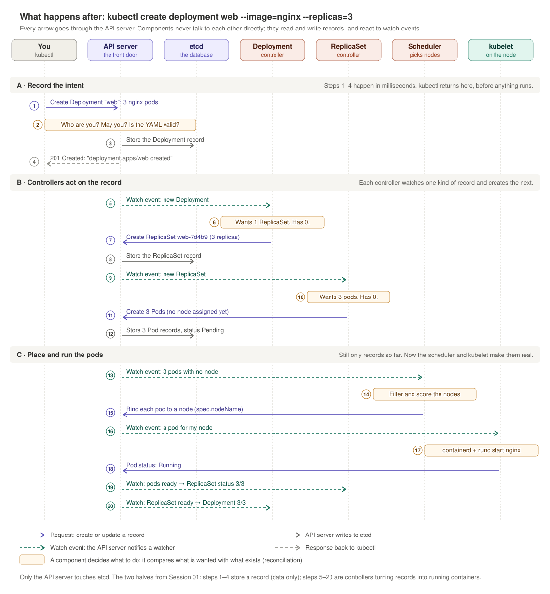

# Session 04: Your own APIs

**Date:** 2026-10-23
**Plan position:** Phase 1, Session 1 of 4 · Project 1 (`AgentSession` operator) begins
**Status:** draft API installed and tested in kind; six design decisions agreed (2026-10-24). Next: Session 05 builds the controller to this spec.

[← Back to index](../index.md) · [Previous: Session 03](03-week3-trust-model.md)

---

## Before you start

### What a CRD is, in plain terms

In Session 01 you ran `kubectl create deployment web`. Two separate things happened:
1. **The API server stored a record**, a Deployment object, in etcd. A record is just data: "I want 3 nginx pods."
2. **A controller noticed the record and acted on it,** creating a ReplicaSet and then pods.

Think of the API server as a database:
- Each **resource type** (Pods, Deployments) is a **table** with defined columns.
- Each **object** (your `web` Deployment) is a **row** in that table.
- Each **controller** is a **background worker** that watches one table and makes the real world match its rows.

**A CRD (CustomResourceDefinition) adds a new table.** It tells the API server to accept a new type of record, such as `AgentSession`, with certain fields. It doesn't run anything.

**A custom resource is a row** in that table, like the `research-task-42` session below. **An operator is a CRD plus a controller you write:** a new table, plus a worker that turns its rows into real things, such as pods.

### The whole flow, step by step



Three phases:
- **A · Record the intent (steps 1–4):** the API server checks who you are, whether you're allowed and whether the YAML is valid, stores the record in etcd and replies "created". kubectl returns here, before any container exists.
- **B · Controllers act on the record (steps 5–12):** the Deployment controller creates a ReplicaSet; the ReplicaSet controller creates 3 pods. Each handles one kind of record and creates the next; they never call each other.
- **C · Place and run the pods (steps 13–20):** the scheduler picks a node for each pod, the node's kubelet starts the container, and status flows back up.

Every arrow touches the API server, the only component that talks to etcd. Steps 6, 10 and 14 are the same pattern: **watch, compare "wanted" with "exists", act.** For a CRD, your `AgentSession` replaces the Deployment in step 1 and your controller replaces the Deployment controller in steps 5–7. Without a controller the chain stops after step 5, which is why no pod appeared in this session's lab.

### Kubernetes is this pattern, repeated

The controller manager in the `learn` cluster (v1.37) runs **46 controllers** (49 built in, 3 off by default):

| Area | Examples | What they do |
|---|---|---|
| Workloads | `deployment`, `replicaset`, `statefulset`, `daemonset`, `job`, `cronjob`, `horizontal-pod-autoscaler` | Turn workload records into pods |
| Nodes | `node-lifecycle`, `taint-eviction`, `node-ipam` | Notice dead nodes, evict their pods, hand out pod IP ranges |
| Networking | `endpoints`, `endpointslice`, `service-cidr` | Track which pods back each Service |
| Storage | `persistentvolume-binder`, `attach-detach` | Match storage claims to disks and attach them |
| Identity | `serviceaccount`, `serviceaccount-token`, `certificatesigningrequest-signing`, `root-ca-certificate-publisher` | Service accounts, tokens, certificate signing with `ca.key` |
| Housekeeping | `garbage-collector`, `namespace`, `resourcequota` | Delete owned objects when their owner goes, empty deleted namespaces, enforce quotas |

Outside the controller manager: the **scheduler**, **kubelet** and **kube-proxy** are controllers too, as are the **cloud controller manager** and add-ons like cert-manager, Karpenter, KEDA and Argo CD.

**One review question for any controller your team proposes:** *what does it watch, what does it change, and with what permissions?* Its permissions are its blast radius.

### Other key terms in this session

- **API group and version:** every resource type belongs to a group and has a version. `agents.example.dev/v1alpha1` means group `agents.example.dev`, version `v1alpha1`. **alpha** means "may change without warning", **beta** "mostly stable", **v1** "stable, won't break".
- **Kind:** the type name of an object, like `Deployment` or `AgentSession`.
- **Namespaced vs. cluster-scoped:** namespaced resources live inside a namespace (like pods); cluster-scoped ones exist once for the whole cluster (like nodes).
- **Schema (OpenAPI schema):** the CRD's description of which fields exist, their types and their rules. The API server uses it to check every object.
- **Validation:** rejecting bad input before it's stored, such as a wrong type, a missing required field, or a number out of range.
- **CEL (Common Expression Language):** a small language for custom validation rules that compare fields, like "idle timeout must not exceed lifetime".
- **Defaulting:** filling in fields the user left out, such as `runtime: gvisor`.
- **spec and status:** `spec` is what the user wants; `status` is what's actually true, written only by the controller.
- **Subresource (`/status`):** a separate endpoint for part of an object. With a status subresource, normal updates can't change status, and permissions can be granted separately.
- **Printer columns:** extra columns `kubectl get` shows for a custom resource.
- **Short name:** an abbreviation for `kubectl`, like `as` for `agentsessions`.
- **Conditions:** a list of facts in an object's status, each with a type, a true/false/unknown value, and a reason, such as "SandboxReady: False, image pull failed".
- **Phase:** a single summary word for an object's state, like `Pending` or `Ready`.
- **observedGeneration:** a counter that tells you whether the controller has caught up with the latest change to the spec.
- **ResourceQuota:** a per-namespace cap on total resources, such as the CPU and memory all of one tenant's sessions may use together.
- **Admission policy:** a rule checked when an object is created or changed, after authorization and before it's stored, such as "only platform namespaces may use runc". Covered in Session 06.
- **Egress:** network traffic leaving a pod, toward the internet or other services.
- **Tenant:** one customer or team sharing the platform with others; here, one namespace each.
- **Kubebuilder:** a tool that generates the skeleton of an operator in Go. Used in Session 05.

### Read first

Before the lab, read the first three articles in [Resources](#resources) at the end of this file (about 60 minutes), and watch the short IBM video if anything here feels abstract.

---

## The idea

Everything in Kubernetes is an **API object plus a control loop**. A **CustomResourceDefinition (CRD)** adds your own object type to the API server. Add a **controller** that reconciles it (Session 05) and the pair is an **operator**.

Building the platform as `kind: AgentSession` instead of a separate service gets you, for free:
- `kubectl`, GitOps and every Kubernetes client work with it immediately
- RBAC decides who can create sessions
- the API server validates input and stores it in etcd
- watches let controllers react to changes

**For a manager:** a CRD is a **public contract**. Users write YAML against it, tools depend on it, and changing it later means versioning and migrations. Reviewing a CRD is reviewing a product API.

## The draft API

Files: [`labs/phase1/agentsession-crd.yaml`](../labs/phase1/agentsession-crd.yaml), [`labs/phase1/sample-session.yaml`](../labs/phase1/sample-session.yaml).

What a user writes:

```yaml
apiVersion: agents.example.dev/v1alpha1
kind: AgentSession
metadata:
  name: research-task-42
  namespace: tenant-acme
spec:
  image: python:3.12-slim
  ttlSeconds: 1800
  idleTimeoutSeconds: 300
  egress:
    allowedDomains: [pypi.org, api.github.com]
```

Design choices in the draft:
- **Users set `spec`; only the controller sets `status`.**
- **`runtime` defaults to `gvisor`.** Allowed values: `gvisor`, `runc`.
- **No network unless listed.** An empty `egress` means no network.
- **Every session dies:** `ttlSeconds` defaults to 3600 (min 60, max 86400), plus an optional `idleTimeoutSeconds`, which must not exceed it.
- **A namespace is a tenant.**
- **Status** has `phase` (Pending, Ready, Idle, Terminating, Terminated, Failed), `conditions`, `podName`, `startedAt`, `lastActivityAt` and `observedGeneration`.

## Lab steps

Every command from the lab, in order, with the output to expect and what it means. Run them from the learning-log folder (the one containing `labs/`). They use the `learn` kind cluster from Session 01; `--context kind-learn` makes sure each command goes to that cluster.

### Step 0 (optional): start clean

The lab's objects are still in the cluster from 2026-10-23. To run everything from scratch, delete them first. Deleting the CRD also deletes every `AgentSession`; deleting the namespace deletes everything in it.

```bash
kubectl --context kind-learn delete namespace tenant-acme --ignore-not-found
```

```bash
kubectl --context kind-learn delete crd agentsessions.agents.example.dev --ignore-not-found
```

### Step 1: Install the CRD

```bash
kubectl --context kind-learn apply -f labs/phase1/agentsession-crd.yaml
```

Expected output:

```
customresourcedefinition.apiextensions.k8s.io/agentsessions.agents.example.dev created
```

**What it means:** you sent the API server a *definition*: "accept a new record type called `AgentSession`, with these fields and rules." In table terms, you created a new table. Nothing runs yet.

### Step 2: Wait until the API server accepts it

```bash
kubectl --context kind-learn wait --for condition=established crd/agentsessions.agents.example.dev --timeout=30s
```

Expected output:

```
customresourcedefinition.apiextensions.k8s.io/agentsessions.agents.example.dev condition met
```

**What it means:** "established" is a condition on the CRD itself: the API server has finished setting up the new endpoint and is ready to accept `AgentSession` objects. It usually takes about a second.

### Step 3: Confirm Kubernetes knows the new type

```bash
kubectl --context kind-learn api-resources --api-group=agents.example.dev
```

Expected output:

```
NAME            SHORTNAMES   APIVERSION                    NAMESPACED   KIND
agentsessions   as           agents.example.dev/v1alpha1   true         AgentSession
```

**What it means:** the API server now lists `agentsessions` next to built-in types like pods. `as` is the short name, `v1alpha1` the version, and `NAMESPACED: true` means each session lives in a namespace, which is how tenants are separated.

### Step 4: Read the documentation Kubernetes generated

```bash
kubectl --context kind-learn explain agentsession.spec.runtime
```

Expected output (start):

```
GROUP:      agents.example.dev
KIND:       AgentSession
VERSION:    v1alpha1

FIELD: runtime <string>
ENUM:
    gvisor
    runc
```

**What it means:** `kubectl explain` works for your type exactly as for built-in ones, generated from the CRD's schema. Users can discover the API without separate docs.

If you get `couldn't find resource`, wait a few seconds and retry: kubectl keeps a cached list of API types, which can lag behind a brand-new CRD.

### Step 5: Create a tenant and a session

```bash
kubectl --context kind-learn create namespace tenant-acme
```

```bash
kubectl --context kind-learn apply -f labs/phase1/sample-session.yaml
```

Expected output:

```
namespace/tenant-acme created
agentsession.agents.example.dev/research-task-42 created
```

**What it means:** the namespace `tenant-acme` represents one customer. The session `research-task-42` is a record (a "row") in the new table. The API server validated it against the schema and stored it in etcd.

### Step 6: List it

```bash
kubectl --context kind-learn get agentsessions -n tenant-acme
```

Expected output:

```
NAME               PHASE   RUNTIME   TTL    AGE
research-task-42           gvisor    1800   0s
```

**What it means:**
- **The columns** (PHASE, RUNTIME, TTL) come from the CRD's `additionalPrinterColumns`.
- **RUNTIME says `gvisor`** although `sample-session.yaml` never set it: the schema's default was applied when the object was stored.
- **PHASE is empty** because phase is part of `status`, and only a controller writes status. There's no controller yet.

### Step 7: See exactly what was stored

```bash
kubectl --context kind-learn get agentsession research-task-42 -n tenant-acme -o yaml
```

Expected `spec` section:

```yaml
spec:
  egress:
    allowedDomains:
    - pypi.org
    - api.github.com
  idleTimeoutSeconds: 300
  image: python:3.12-slim
  runtime: gvisor
  ttlSeconds: 1800
```

**What it means:**
- `runtime: gvisor` was added by defaulting.
- **`resources` is missing**, even though the CRD gives `cpu` and `memory` defaults. Defaults inside a nested object apply only when the user includes that object. So this session has **no resource limits**: the bug that led to decision 2.
- There's no `status` section at all: nothing has reported on this session.
- Above `spec`, the `metadata` section shows fields you met in Session 01, such as `resourceVersion` (used to detect conflicting writes) and `generation` (which counts changes to the spec).

### Step 8: Check for pods

```bash
kubectl --context kind-learn get pods -n tenant-acme
```

Expected output:

```
No resources found in tenant-acme namespace.
```

**What it means:** this is the key result. The record exists, but no sandbox was created, because **a CRD only defines the record; a controller has to act on it.** In the [flow diagram](../assets/deployment-to-pods-flow.svg), the chain stops after step 5: the watch event fires, but nothing is listening. Session 05 writes that controller.

### Step 9: Try invalid sessions

Each command below sends one bad session. The schema should reject the first four before anything is stored.

**An unknown runtime:**

```bash
kubectl --context kind-learn apply -f - <<'EOF'
apiVersion: agents.example.dev/v1alpha1
kind: AgentSession
metadata: {name: bad, namespace: tenant-acme}
spec: {image: python:3.12-slim, runtime: firecracker}
EOF
```

Expected: `spec.runtime: Unsupported value: "firecracker": supported values: "gvisor", "runc"`

**A missing image:**

```bash
kubectl --context kind-learn apply -f - <<'EOF'
apiVersion: agents.example.dev/v1alpha1
kind: AgentSession
metadata: {name: bad, namespace: tenant-acme}
spec: {runtime: gvisor}
EOF
```

Expected: `spec.image: Required value`

**A 7-day lifetime:**

```bash
kubectl --context kind-learn apply -f - <<'EOF'
apiVersion: agents.example.dev/v1alpha1
kind: AgentSession
metadata: {name: bad, namespace: tenant-acme}
spec: {image: python:3.12-slim, ttlSeconds: 604800}
EOF
```

Expected: `spec.ttlSeconds in body should be less than or equal to 86400`

**An idle timeout longer than the lifetime:**

```bash
kubectl --context kind-learn apply -f - <<'EOF'
apiVersion: agents.example.dev/v1alpha1
kind: AgentSession
metadata: {name: bad, namespace: tenant-acme}
spec: {image: python:3.12-slim, ttlSeconds: 600, idleTimeoutSeconds: 900}
EOF
```

Expected: `idleTimeoutSeconds must not exceed ttlSeconds`. This one comes from the custom CEL rule in the CRD, which compares two fields.

**Opting out of gVisor:**

```bash
kubectl --context kind-learn apply -f - <<'EOF'
apiVersion: agents.example.dev/v1alpha1
kind: AgentSession
metadata: {name: bad, namespace: tenant-acme}
spec: {image: python:3.12-slim, runtime: runc}
EOF
```

Expected: `agentsession.agents.example.dev/bad created`

The first two also print a second line, `some validation rules were not checked because the object was invalid`. That just means the custom rules were skipped because basic checks already failed.

**What it means:** the first four were rejected by the API server with clear messages: input checking you got without writing code. The last one was **accepted**: any user can skip the sandbox. The schema checks the *shape* of input, not *who* is asking. That gap led to decision 1, enforced later by an admission policy (Session 06).

Remove the accepted bad session:

```bash
kubectl --context kind-learn delete agentsession bad -n tenant-acme
```

### Step 10: Try to fake the status

First, as a user would, through the normal endpoint:

```bash
kubectl --context kind-learn patch agentsession research-task-42 -n tenant-acme --type merge -p '{"status":{"phase":"Ready"}}'
```

Expected output:

```
agentsession.agents.example.dev/research-task-42 patched (no change)
```

Then as the controller would, through the status subresource:

```bash
kubectl --context kind-learn patch agentsession research-task-42 -n tenant-acme --subresource=status --type merge -p '{"status":{"phase":"Pending","observedGeneration":1}}'
```

```bash
kubectl --context kind-learn get agentsessions -n tenant-acme
```

Expected output:

```
agentsession.agents.example.dev/research-task-42 patched
NAME               PHASE     RUNTIME   TTL    AGE
research-task-42   Pending   gvisor    1800   ...
```

**What it means:** because the CRD declares a `status` subresource, the normal endpoint silently ignores status changes ("no change"). Only the separate `/status` endpoint can set it, and permissions for it are granted separately. So users can't make a session look "Ready"; only the controller will be allowed to.

### Step 11: Give a tenant user narrow permissions

Create a Role that allows managing sessions in `tenant-acme`, and grant it to a user called `alice`:

```bash
kubectl --context kind-learn create role session-user -n tenant-acme --verb=get,list,watch,create,patch,delete --resource=agentsessions.agents.example.dev
```

```bash
kubectl --context kind-learn create rolebinding alice-session-user -n tenant-acme --role=session-user --user=alice
```

Expected output:

```
role.rbac.authorization.k8s.io/session-user created
rolebinding.rbac.authorization.k8s.io/alice-session-user created
```

**What it means:** a Role is a list of allowed actions in one namespace; a RoleBinding grants it to a user. `alice` doesn't need to exist anywhere: Kubernetes has no user database, so permissions attach to whatever name a certificate or token presents (Session 03).

### Step 12: Check what alice can do

`kubectl auth can-i` asks the API server "would this be allowed?" without doing it. `--as=alice` asks on alice's behalf.

```bash
kubectl --context kind-learn auth can-i create agentsessions -n tenant-acme --as=alice
```
Expected: `yes`

```bash
kubectl --context kind-learn auth can-i patch agentsessions --subresource=status -n tenant-acme --as=alice
```
Expected: `no`

```bash
kubectl --context kind-learn auth can-i create pods -n tenant-acme --as=alice
```
Expected: `no`

```bash
kubectl --context kind-learn auth can-i get secrets -n tenant-acme --as=alice
```
Expected: `no`

```bash
kubectl --context kind-learn auth can-i create agentsessions -n tenant-globex --as=alice
```
Expected: `no`

Finally, the real attempt to fake status, as alice:

```bash
kubectl --context kind-learn patch agentsession research-task-42 -n tenant-acme --as=alice --subresource=status --type merge -p '{"status":{"phase":"Ready"}}'
```

Expected: `Error from server (Forbidden): ... User "alice" cannot get resource "agentsessions/status" ...`

**What it means:** alice can create and manage sessions in her own namespace, and nothing else: no pods, no Secrets, no status, no other tenant. **This is the core argument for building the platform as an operator:** users get one narrow permission ("create an AgentSession") instead of dangerous broad ones ("create any pod"). The controller holds the pod permissions and decides what the pods look like.

*Gotcha:* don't write `kubectl auth can-i patch agentsessions/status`. kubectl reads `status` as the *name* of a session and wrongly answers `yes`. Use `--subresource=status`.

### What stays in the cluster

The CRD, the `tenant-acme` namespace, `research-task-42`, the `session-user` Role and alice's RoleBinding stay for Session 05.

## What the lab showed (summary)

**1. A CRD is only half an operator.** After `kubectl apply`, the API server served `agentsessions` (short name `as`) immediately, with no restart or code. The sample session was accepted, validated, stored and listed with custom columns, but **no pod was created and `PHASE` stayed empty**. Nothing acts on the object until a controller exists. It's Session 01 in reverse: there you removed a loop; here there's an API with no loop at all.

**2. Defaults are applied on the way in.** The stored object had `runtime: gvisor` although the YAML didn't set it. Users get the safe choice without asking.

**3. Found a bug in the draft: no resource limits.** The `resources` defaults (`500m` CPU, `512Mi` memory) were *not* applied, because defaults inside a nested object apply only when the user includes that object. The sample session has no limits, so one runaway agent could starve its node. Exactly what a design review should catch (decision 2 below).

**4. Validation is free and runs before any code.** Rejected at the API server:

| Input | Error |
|---|---|
| `runtime: firecracker` | `Unsupported value: "firecracker": supported values: "gvisor", "runc"` |
| no `image` | `spec.image: Required value` |
| `ttlSeconds: 604800` (7 days) | `should be less than or equal to 86400` |
| `ttlSeconds: 600`, `idleTimeoutSeconds: 900` | `idleTimeoutSeconds must not exceed ttlSeconds` (a custom CEL rule) |
| `runtime: runc` | **accepted** |

**The last row is a policy gap:** any user can opt out of gVisor. The schema checks the *shape* of input, not *who* is asking. That's a policy question for admission control (Session 06) and decision 1 below.

**5. Users can't fake status.** Patching `status.phase: Ready` through the normal endpoint was silently ignored ("patched (no change)"). Only the status subresource (`--subresource=status`) could set it.

**6. RBAC gives users a narrow permission instead of dangerous ones.** With a `session-user` Role bound to `alice` in `tenant-acme`:

| alice may... | Answer |
|---|---|
| create or patch `agentsessions` in `tenant-acme` | yes |
| patch the `agentsessions` **status** subresource | no (Forbidden) |
| create `pods` in `tenant-acme` | no |
| get `secrets` in `tenant-acme` | no |
| create `agentsessions` in `tenant-globex` | no |

**The core security argument for an operator:** users get "create an AgentSession", not "create any pod". The controller holds the pod permissions and decides what pods look like.

*Gotcha:* `kubectl auth can-i patch agentsessions/status` reads `status` as a session **name** and wrongly says yes. Use `kubectl auth can-i patch agentsessions --subresource=status`.

## Design decisions (agreed 2026-10-24)

You reviewed the draft as the design reviewer and accepted all six recommendations.

| # | Question | Decision | Why |
|---|---|---|---|
| 1 | Who may run a session without the gVisor sandbox? | **Keep `runtime`, default `gvisor`. Only platform-team namespaces may set `runc`,** enforced by an admission policy (Session 06). | Opting out puts every tenant on the node at risk, because plain containers share the kernel. The platform team occasionally needs plain containers for debugging; customers never do. |
| 2 | Resource limits | **Both: a default for every session, and a per-tenant cap** (a ResourceQuota on each tenant namespace). | The default protects nodes from one runaway agent; the cap stops one tenant from claiming the cluster. Fixes the missing-defaults bug. |
| 3 | How a session reports its state | **Both `conditions` and `phase`, with `phase` derived from the conditions.** | Dashboards need one word; on-call engineers need the reason. |
| 4 | What separates tenants | **A namespace per tenant.** | Permissions, quotas and network rules all work per namespace. A `tenant` field would mean rebuilding that, with one bug away from mixing customers' data. |
| 5 | Who decides which sites an agent can reach | **Users pick a platform-approved egress profile** (e.g. `egressProfile: python-packages`), not free-form domains. | The session author is often another agent, possibly prompt-injected. Free-form domains are an easy exfiltration path. Security reviews profiles once. |
| 6 | Maximum lifetime, and the work at the end | **The platform owns the maximum, set per tenant; users may only ask for less.** The session reports an "expiring soon" condition, and its workspace lives on a volume that outlives the pod. | Kubernetes restores pods, not sessions (Session 01). Without this, an agent hitting the limit loses its work. |

### API changes these decisions imply (the spec for Session 05)

| Change | From decision |
|---|---|
| Default the whole `spec.resources` object (`cpu: 500m`, `memory: 512Mi`) so every session gets limits | 2 |
| Add a ResourceQuota to each tenant namespace | 2 |
| Replace `spec.egress.allowedDomains` with `spec.egressProfile` (a name), plus a platform-owned profile list that maps names to domains | 5 |
| Remove the hard-coded 86400-second maximum from the schema; the controller enforces each tenant's maximum instead | 6 |
| Add a `spec.workspace` volume that survives the pod | 6 |
| Define the conditions: e.g. `SandboxReady`, `Expiring`, `Failed`; derive `phase` from them | 3, 6 |
| Admission policy: `runtime: runc` allowed only in platform-team namespaces | 1 (Session 06) |

Unchanged: `runtime` defaults to `gvisor`; namespaces are tenants; users set `spec`, only the controller sets `status`.

## Cleanup

The CRD, `tenant-acme` namespace, sample session, `session-user` Role and binding stay in the `learn` cluster for Session 05.


## Resources

### Books
- *Kubernetes Patterns*, 2nd ed. (Ibryam, Huß). Chapters: "Controller" and "Operator". The best explanation of *why* the pattern works. Read before Session 05.
- *Programming Kubernetes* (Hausenblas, Schimanski). Chapter 4, "Using Custom Resources", and Chapter 6, "Solutions for Writing Operators". The engineer's view: how CRDs are stored and served, and the tools for building operators (including Kubebuilder).
- *Kubernetes: Up and Running*, 3rd ed. Chapter: "Extending Kubernetes". A short overview of CRDs and operators.

### Articles and docs
Read 1–3 before the session (about 60 minutes):
1. [Custom Resources](https://kubernetes.io/docs/concepts/extend-kubernetes/api-extension/custom-resources/): what they are and when to use one.
2. [Operator pattern](https://kubernetes.io/docs/concepts/extend-kubernetes/operator/): CRD plus controller, with examples.
3. [Extend the Kubernetes API with CustomResourceDefinitions](https://kubernetes.io/docs/tasks/extend-kubernetes/custom-resources/custom-resource-definitions/): read up to and including validation and defaulting.

Then, as reference:
- [Kubernetes API Conventions](https://github.com/kubernetes/community/blob/master/contributors/devel/sig-architecture/api-conventions.md): the official guide to spec vs. status, conditions and naming. What your team's API reviews should check against.
- [Resource Quotas](https://kubernetes.io/docs/concepts/policy/resource-quotas/): per-tenant caps (decision 2).
- [Using RBAC Authorization](https://kubernetes.io/docs/reference/access-authn-authz/rbac/): the Roles and RoleBindings used for alice.
- [The Kubebuilder Book](https://book.kubebuilder.io/): the tool for Session 05.

### Videos
- [Kubernetes Operators Explained](https://www.youtube.com/watch?v=i9V4oCa5f9I) (IBM Technology, short whiteboard explainer). The operator idea in plain language. Watch this first if anything above feels abstract.
- [Kubernetes Deconstructed](https://www.youtube.com/watch?v=90kZRyPcRZw) (Carson Anderson, KubeCon). From Session 01; rewatch the parts on the API server and controllers with CRDs in mind.

---

**Next:** Session 05, controllers: Claude Code scaffolds the operator with Kubebuilder, you review the reconcile loop, and we break it on purpose. Needs Go and Kubebuilder installed.
